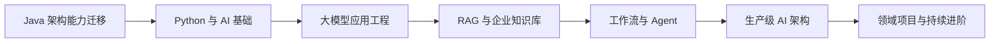

# Java 架构师转型 AI 应用开发架构师：学习进阶路线

> 目标：从“业务系统架构师”升级为“能够设计、落地并持续运营企业级 AI 应用的技术架构师”。
>
> 建议周期：6 个月完成主线，9～12 个月形成复杂项目独立架构能力。
>
> 建议投入：每周 10～12 小时，其中至少 60% 用于编码、实验和项目复盘。

## 一、先明确转型目标

### 1. 目标岗位的核心职责

AI 应用开发架构师不是单纯训练模型，也不只是调用大模型 API，而是负责：

- 将业务目标拆解为可验证的 AI 能力与工程质量指标。
- 设计大模型、知识库、业务系统和数据平台之间的整体架构。
- 选择适合场景的模型、RAG、工作流或 Agent 技术方案。
- 解决幻觉、权限、数据安全、稳定性、延迟和成本问题。
- 建立评测、观测、灰度发布与持续迭代体系。
- 带领团队完成从 PoC 到生产环境的交付。

### 2. Java 架构师已有优势

以下能力可以直接复用，不需要从零开始：

| 已有能力 | 在 AI 应用中的价值 |
| --- | --- |
| 分布式系统与微服务 | 设计模型网关、异步任务、检索服务和 Agent 服务 |
| 高并发与高可用 | 处理限流、超时、重试、降级、熔断和多模型容灾 |
| 领域建模与业务架构 | 识别真正适合 AI 的业务环节，避免“为了 AI 而 AI” |
| 数据治理与权限设计 | 建设可信知识库，落实文档级、数据级访问控制 |
| DevOps 与可观测性 | 建立 LLMOps、质量评测、链路追踪和成本治理 |
| 团队协作与技术决策 | 推动业务、算法、数据和研发团队协同交付 |

### 3. 主要能力缺口

转型重点应放在以下六个方面：

1. **AI 基础认知**：理解模型能力边界、训练与推理的基本原理。
2. **大模型应用工程**：提示词、结构化输出、工具调用、上下文管理。
3. **知识增强**：Embedding、向量检索、混合检索、重排和 RAG 评测。
4. **Agent 与工作流**：任务规划、状态管理、人工审批和失败恢复。
5. **生产级架构**：模型路由、质量评测、安全、性能、成本和可观测性。
6. **Python 技术生态**：能够阅读、调试和改造主流 AI 框架与模型服务代码。

## 二、总体学习路线

学习时坚持三条原则：

- **先应用，后原理，再深入底层**：先做出可运行系统，再补 Transformer、推理优化等知识。
- **先确定性工作流，后自主 Agent**：能由固定流程解决的问题，不盲目使用多 Agent。
- **先建立评测，再优化效果**：没有测试集和指标，就无法判断修改是否有效。

## 三、六个月主线计划

## 阶段 0：环境准备与认知切换（第 1 周）

### 学习目标

- 理解传统软件与 AI 应用的核心差异。
- 建立 Java 与 Python 双技术栈的开发环境。
- 跑通第一个大模型应用。

### 学习内容

- 传统确定性逻辑与模型概率性输出的差异。
- 大模型的上下文窗口、Token、温度、最大输出长度等概念。
- 同步、流式、结构化输出三种调用方式。
- Python 虚拟环境、包管理、类型注解和基础异步编程。
- API Key 管理，禁止将密钥写入代码库或日志。

### 实践任务

开发一个“统一模型调用 Demo”，至少支持：

- 一个云端模型 API。
- 普通调用与流式输出。
- 超时、重试和异常处理。
- Token 用量、耗时和成本日志。
- Java 服务通过 HTTP 调用该能力。

### 阶段验收

- 能解释为什么相同输入可能得到不同输出。
- 能计算一次请求的 Token 成本与端到端延迟。
- 能说明为什么 AI 功能不能直接替代所有业务规则。

---

## 阶段 1：Python 与 AI 基础（第 2～4 周）

### 学习目标

具备阅读和开发 AI 应用代码的能力，理解必要原理，但不在数学推导上消耗过多时间。

### 学习内容

#### Python 工程能力

- 函数、类、模块、异常、类型注解。
- `venv` 或 `uv`、依赖管理、格式化与测试。
- `asyncio`、异步 HTTP、并发控制。
- FastAPI、Pydantic、Pytest。
- 日志、配置管理、Docker 打包。

#### AI 基础概念

- 监督学习、无监督学习、训练、验证、推理。
- 特征、标签、损失函数、过拟合等基本概念。
- 神经网络、Embedding、Transformer 的直觉性理解。
- 预训练、指令微调、对齐、LoRA 的适用边界。
- 模型参数规模、上下文长度、量化与推理成本的关系。

### Java 开发者的学习建议

- 不必先成为算法工程师，也不要从完整推导反向传播开始。
- 优先掌握 NumPy 的数据思维，了解 PyTorch 的张量与推理流程即可。
- 遇到陌生框架时，重点阅读输入输出、状态流转和扩展接口。

### 实践任务

用 FastAPI 实现一个“模型适配服务”：

- 统一不同模型供应商的请求和响应格式。
- 使用 Pydantic 校验结构化数据。
- 支持异步并发、超时与统一异常。
- 编写单元测试和接口测试。
- 使用 Docker 一键启动。

### 阶段验收

- 能独立编写和调试一个 Python 后端服务。
- 能向团队解释 Embedding、Transformer、微调和 RAG 分别解决什么问题。
- 能判断一个需求应通过提示词、知识检索、工具调用还是微调解决。

---

## 阶段 2：大模型应用工程（第 5～8 周）

### 学习目标

从“会调用模型”进阶为“能构建稳定、可控的大模型功能”。

### 学习内容

#### 提示词与上下文工程

- 系统指令、任务说明、约束、示例和输出格式。
- Few-shot 示例的选取与维护。
- 上下文窗口管理、历史压缩、信息优先级。
- 提示词版本管理和变更回归。
- 不把提示词当成安全边界，关键规则仍需代码控制。

#### 可控输出与工具调用

- JSON Schema 等结构化输出约束。
- Function Calling / Tool Calling 的协议和参数校验。
- 工具超时、幂等、权限校验和异常返回。
- 流式响应、取消请求和背压处理。
- 多轮对话状态、短期记忆与长期记忆的边界。

#### Java 集成方案

- 在现有 Java 系统中通过独立 AI 服务集成模型能力。
- 学习 Spring AI 或 LangChain4j，选择一个作为主用框架。
- 对模型 SDK 和框架进行防腐层封装，避免业务代码绑定供应商。
- 对低延迟链路、异步批处理和长任务分别设计调用模式。

### 实践任务

开发“智能业务工单助手”：

- 从自然语言中抽取工单字段，输出严格 JSON。
- 调用模拟业务工具查询客户、订单或服务状态。
- 缺少必要信息时主动追问，不自行编造。
- 对写操作增加参数校验、权限检查和人工确认。
- 保存提示词版本、模型版本、耗时和 Token 用量。

### 阶段验收

- 结构化输出可被业务服务稳定解析，异常输入有明确处理策略。
- 工具调用失败不会导致无限重试或重复写入。
- 能设计兼容多个模型供应商的统一抽象层。

---

## 阶段 3：RAG 与企业知识库（第 9～12 周）

### 学习目标

掌握企业 AI 应用最常见的知识增强架构，并能用数据证明回答质量。

### 学习内容

#### 数据接入与知识加工

- 文档解析、OCR、表格与图片处理的基本策略。
- 清洗、去重、切分、元数据和知识版本管理。
- 按语义、标题层级或固定窗口切分的取舍。
- 增量更新、删除同步、重建索引和失败补偿。

#### 检索与生成

- Embedding 模型与向量维度、距离度量。
- 向量数据库的核心概念：索引、过滤、TopK、召回。
- 关键词检索、向量检索、混合检索与 Rerank。
- Query 改写、多路召回、上下文组装和引用溯源。
- “未检索到依据”时拒答，而不是强制模型回答。

#### 权限与质量

- 在检索阶段执行租户、部门、用户和文档级权限过滤。
- 建立覆盖事实性、权限、拒答和长尾问题的测试集。
- 分别评估检索质量与生成质量，避免只看最终回答。
- 关注 Recall@K、MRR、引用正确率、答案忠实度等指标。

### 实践任务

开发“企业知识问答系统”：

- 支持多种文档导入、增量更新和删除。
- 支持混合检索、重排、引用来源和权限过滤。
- 建立至少 50～100 条人工标注问题及标准依据。
- 输出检索与生成两组评测结果。
- 对无答案、无权限和文档冲突场景设计明确策略。

### 阶段验收

- 能定位“解析错误、切分错误、召回错误、排序错误、生成错误”中的具体环节。
- 每次调整切分、Embedding 或提示词后，都能通过固定测试集对比效果。
- 权限隔离由检索与业务代码保证，而非仅依赖提示词。

---

## 阶段 4：AI 工作流与 Agent（第 13～16 周）

### 学习目标

能够为复杂任务选择合适的工作流或 Agent，并保证执行过程可控、可恢复、可审计。

### 学习内容

#### 工作流优先

- 顺序、并行、条件分支、循环和人工审批节点。
- 状态机、检查点、幂等和断点续跑。
- 模型步骤与确定性代码步骤的职责划分。
- 使用有限状态工作流替代不必要的开放式自主规划。

#### Agent 核心机制

- ReAct 等基本模式及其局限。
- 任务规划、工具选择、执行观察和结果校验。
- 上下文隔离、子任务边界和共享状态管理。
- 最大步数、最大成本、超时、循环检测和终止条件。
- Human-in-the-loop：高风险操作必须审批。

#### 工具生态

- 理解 MCP 等工具接入协议的作用与边界。
- 工具描述、参数 Schema、错误协议和权限模型。
- 外部工具与不可信内容带来的提示词注入风险。
- 多 Agent 仅在职责确实需要隔离时采用，不作为默认架构。

### 实践任务

开发“运维故障辅助分析 Agent”：

- 按工作流采集日志、指标和变更记录。
- 使用只读工具完成分析，生成带证据的诊断报告。
- 对重启、回滚等写操作设置独立审批节点。
- 支持超时终止、失败恢复、步骤审计和成本上限。
- 对注入文本、异常工具和重复执行进行测试。

### 阶段验收

- 能解释为什么选择工作流、单 Agent 或多 Agent。
- 每个工具调用均可审计，每个高风险动作均可拦截。
- 任一步骤失败后，系统不会无界循环或重复执行有副作用的操作。

---

## 阶段 5：生产级 AI 应用架构（第 17～20 周）

### 学习目标

将项目从“可演示”提升为“可上线、可观测、可治理、可持续优化”。

### 学习内容

#### 架构设计

- AI 能力层、模型接入层、知识与数据层、业务编排层的边界。
- 模型网关：统一鉴权、路由、限流、重试、降级和供应商切换。
- 同步请求、流式响应、异步任务和批处理的选择。
- 缓存、语义缓存、结果复用和上下文裁剪。
- 多租户、数据驻留、审计和敏感数据脱敏。

#### 评测与 LLMOps

- 离线评测、在线评测、人工评审与 A/B 测试。
- 建立黄金测试集、对抗测试集和回归测试集。
- 提示词、模型、知识库和配置的版本关联。
- 灰度发布、回滚、质量门禁和变更审批。
- 持续收集失败样本，形成“评测—优化—回归”闭环。

#### 可观测性与可靠性

- Trace 覆盖模型调用、检索、重排、工具调用和业务写入。
- 监控质量、延迟、Token、费用、错误率和工具成功率。
- 区分模型超时、服务超时和整个任务超时。
- 多模型降级时防止质量不可控，必要时直接拒答或转人工。

#### 安全治理

- 提示词注入、越权检索、数据泄露和不安全工具调用。
- 输入输出内容安全、PII 脱敏、密钥隔离和最小权限。
- 将模型输出视为不可信输入，执行 Schema、业务规则与权限校验。
- 建立内容来源、引用证据、操作日志和责任追踪机制。

### 实践任务

为前述项目补齐生产能力：

- 增加模型网关和至少一种故障降级策略。
- 建立端到端 Trace 与成本看板。
- 建立自动回归评测和上线质量门禁。
- 完成威胁建模和高风险场景测试。
- 编写架构决策记录（ADR），说明模型、检索和部署方案的选择依据。

### 阶段验收

- 能回答“模型不可用时怎么办、回答变差如何发现、费用异常如何控制”。
- 任一线上回答可追溯到模型、提示词、知识版本和工具调用记录。
- 质量、安全、延迟和成本均有可量化指标及负责人。

---

## 阶段 6：综合项目与架构能力固化（第 21～24 周）

### 综合项目建议

从以下方向中选择一个，优先结合自己熟悉的行业：

1. **企业研发知识助手**：需求、代码、接口文档和故障记录统一问答。
2. **智能客服与工单协同**：知识问答、业务查询、工单创建和人工转接。
3. **合同或制度审查助手**：条款定位、风险比对、引用证据和人工复核。
4. **运维 Copilot**：只读诊断、故障归因、变更建议和审批执行。

### 必交付成果

- 一份业务价值与场景边界说明。
- 一套可运行的系统，而不是只有演示页面。
- 一张完整的逻辑架构图和关键链路时序图。
- 一套覆盖正常、异常、对抗和权限场景的评测集。
- 一份质量、性能、安全和成本测试报告。
- 至少三份 ADR：模型选择、RAG/微调选择、工作流/Agent 选择。
- 一份上线、灰度、回滚、应急和持续运营方案。

### 最终验收标准

- **业务**：能解决一个真实问题，并定义人工基线与 AI 改进指标。
- **质量**：核心测试集可重复执行，修改后能够自动回归。
- **安全**：无越权检索，高风险操作受控，敏感数据有保护。
- **可靠性**：模型、检索和工具故障均有处理策略。
- **成本**：能估算单请求、单任务和单用户成本。
- **架构**：关键组件可替换，业务系统不依赖单一模型供应商。

## 四、推荐技术栈：Java 为主，Python 补齐

| 分层 | 推荐能力或技术 | 学习重点 |
| --- | --- | --- |
| 业务系统 | Spring Boot、现有微服务体系 | 领域逻辑、权限、事务和业务工具接口 |
| Java AI 集成 | Spring AI 或 LangChain4j | 模型抽象、结构化输出、工具和 RAG 集成 |
| Python AI 服务 | Python、FastAPI、Pydantic、Pytest | 模型生态接入、检索实验和异步任务 |
| 模型接入 | 云端 API、兼容 OpenAI 协议的网关 | 统一协议、配额、限流、审计和路由 |
| 检索与数据 | PostgreSQL/Elasticsearch、一种向量数据库 | 标量过滤、混合检索、索引和生命周期 |
| 工作流 | 状态机、任务编排框架 | 检查点、幂等、补偿和人工审批 |
| 可观测性 | OpenTelemetry、日志与指标平台 | 全链路 Trace、质量、延迟和成本 |
| 部署 | Docker、Kubernetes、CI/CD | 灰度、回滚、弹性伸缩和资源治理 |

### 技术选型原则

- 不为了“纯 Java”而排除 Python，也不为了追新框架重写稳定业务系统。
- 优先使用团队可维护、可测试、可观测的技术。
- 框架只解决通用编排问题，权限、事务、质量和安全仍由架构保证。
- 初期不必深入 CUDA、分布式训练和推理内核；需要私有化部署或性能优化时再补。

## 五、能力评估模型

可用以下五个等级检查自己的进展：

| 等级 | 能力表现 |
| --- | --- |
| L1：会使用 | 能调用模型 API，完成提示词和简单问答 Demo |
| L2：会开发 | 能实现结构化输出、工具调用和基础 RAG |
| L3：会工程化 | 能建立评测、权限、异常处理、观测和成本控制 |
| L4：会架构 | 能完成模型路由、复杂工作流、安全治理与生产交付 |
| L5：会决策 | 能量化业务价值，主导技术选型、组织协作和持续运营 |

六个月主线的合理目标是达到 **L4 入门**：能够独立负责一个中等复杂度 AI 应用的架构与上线，而不是仅仅完成若干 Demo。

## 六、每周学习节奏

以每周 12 小时为例：

| 活动 | 时间 | 要求 |
| --- | ---: | --- |
| 理论与官方文档 | 3 小时 | 只记录与当前项目相关的关键结论 |
| 编码与实验 | 5 小时 | 每周产生一个可运行增量 |
| 评测与故障复盘 | 2 小时 | 保留失败案例，比较修改前后指标 |
| 架构总结 | 2 小时 | 更新架构图、ADR 或技术笔记 |

每四周进行一次阶段复盘：

1. 本阶段能独立构建什么？
2. 哪些指标证明系统真的变好了？
3. 当前最大的质量、安全或成本风险是什么？
4. 哪些知识只是“知道名词”，还不能实际应用？
5. 下一阶段应删减哪些低价值学习内容？

## 七、常见误区

- **先花数月学习全部数学和机器学习**：会延迟应用实践，初期只需掌握必要概念。
- **把提示词工程当成全部能力**：生产系统的核心还包括检索、权限、评测和可靠性。
- **所有场景都使用 Agent**：固定流程通常更便宜、更稳定、更容易审计。
- **只优化回答 Demo，不建立测试集**：无法证明优化有效，也无法防止回归。
- **把向量数据库等同于 RAG**：解析、切分、权限、重排和生成同样重要。
- **遇到问题就想微调**：优先排查数据、检索、提示词和工具；微调不是知识更新的默认方案。
- **只看模型单价**：总成本还包括检索、重排、上下文、失败重试、人工复核和基础设施。
- **忽略权限与注入风险**：模型输出和外部文档都必须按不可信内容处理。

## 八、后续 6～12 个月进阶方向

完成主线后，根据工作场景选择一个方向深入：

### 方向 A：企业 RAG 与知识工程

- 多模态文档解析、表格和图表理解。
- 知识图谱与向量检索协同。
- 复杂权限、知识版本和跨系统数据治理。
- 面向领域的自动评测与数据飞轮。

### 方向 B：Agent 平台与工具生态

- 长任务状态管理、沙箱、工具权限和审计。
- MCP 服务治理与工具质量评估。
- 多 Agent 的任务隔离、消息协议和成本控制。
- 人机协同审批与责任追踪。

### 方向 C：私有化模型与推理工程

- vLLM 等推理服务、批处理、KV Cache 和量化。
- GPU 容量估算、并发、吞吐、首 Token 延迟。
- 模型微调、LoRA、数据集构建和微调效果评测。
- 私有模型与云端模型的混合路由。

### 方向 D：AI 架构治理与平台建设

- 企业级模型网关、提示词与评测资产管理。
- 多租户配额、 FinOps、内容安全和合规治理。
- AI 应用参考架构、研发规范和质量门禁。
- 跨团队平台运营与技术布道。

## 九、最终学习成果清单

完成转型主线后，应具备以下可展示成果：

- [ ] 一个 Java 主业务系统与 Python AI 服务协同的生产式项目。
- [ ] 一个支持权限、引用、拒答和自动评测的 RAG 系统。
- [ ] 一个支持工具调用、人工审批、失败恢复和审计的工作流或 Agent。
- [ ] 一套模型网关、全链路观测和成本治理方案。
- [ ] 一套黄金测试集、对抗测试集及质量回归流程。
- [ ] 一组架构图、ADR、测试报告和上线运行手册。
- [ ] 一次完整技术分享：讲清业务价值、方案取舍、失败案例与量化结果。

> 转型成功的标志不是“学完多少课程”，而是能够持续交付**有业务价值、质量可验证、风险可控制、成本可运营**的 AI 应用。
